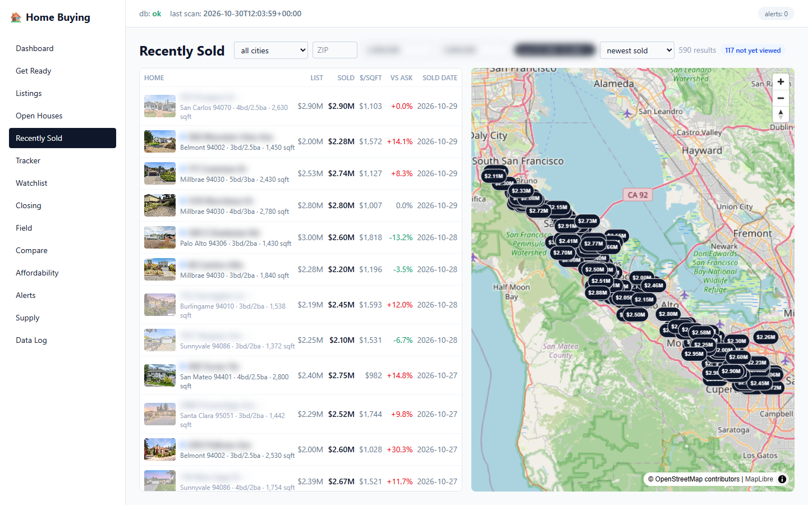
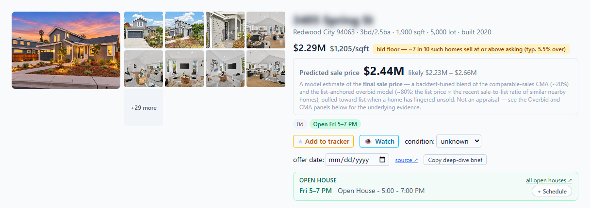
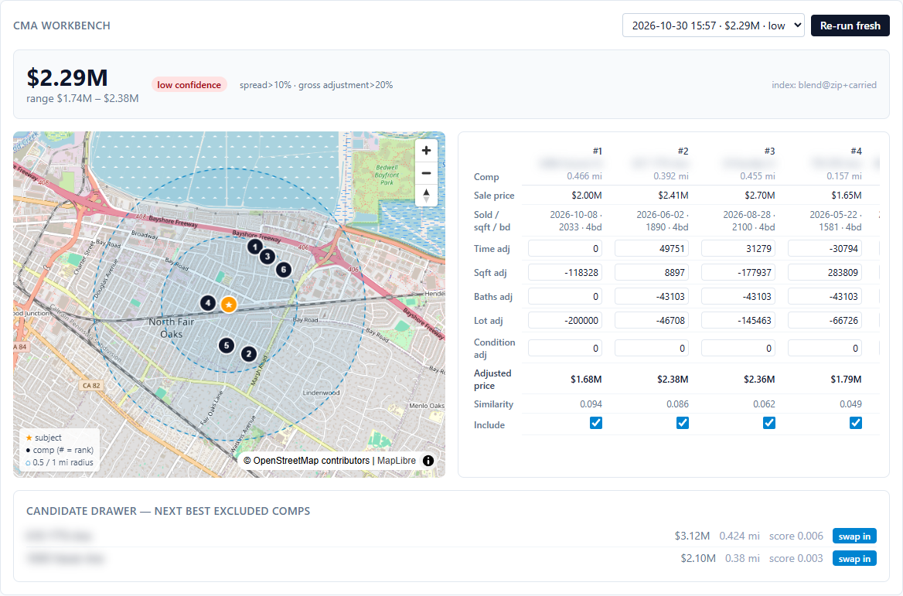
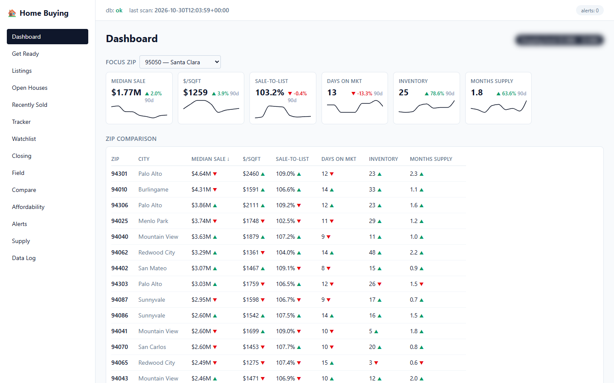
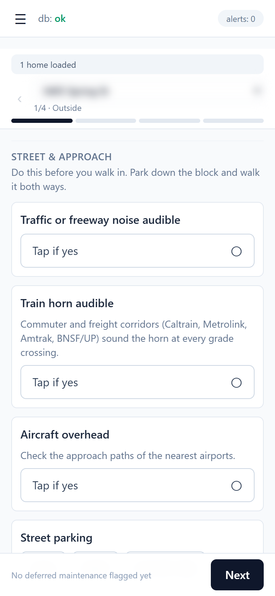

# Home-Buying Intelligence Platform

I built this for my own home search: buying a single-family home as a first-time buyer, without a buyer's agent. It's a personal app: you run your own copy, on your own computer, for the area you're buying in.



## Why I built it

**Recently sold homes are the best guide to what you can afford.** They show you what a given budget actually buys: the quality, the location, the square footage, whether it was renovated. The problem is that once a home sells, Redfin and Zillow take the photos down. Without them, you can't tell *why* a house sold for that price. Was it the brand-new kitchen? The bigger lot? Or just a hot week?

This app keeps the photos. It saves every listing's pictures on your computer while the home is for sale, so after it sells you can still see what the buyer got for their money. Compare a few recent sales and it becomes clear which homes went high because of a beautiful renovation and which ones are closer to what you're looking for.

**It also teaches you how buying works.** As a first-time buyer, I didn't know what to look for: comparable sales, inspections, contingencies, supply, bidding patterns. The app explains each one where you need it, and its checklists walk you from getting ready, through touring, to closing.

## What it does

- **Recently Sold**: every sold home near your price range, with the photos saved while it was listed.
- **Comps**: for any listing, the most similar recent sales nearby, picked automatically. Swap any of them out and see each adjustment for size, condition and features.
- **Sale-price estimate** built from those comps, so you can see exactly where the number comes from.
- **Bid advice**: underbid, bid at list, or overbid, based on how the home is really priced.
- **Listing radar**: price cuts, relists, true days on market, and alerts for new listings.
- **Offer tools**: maximum defensible bid, affordability with your local taxes.
- **Open houses**: this weekend's open houses, your schedule, and a driving route.
- **Market dashboards**: prices, inventory and days on market by ZIP.
- **Field**: a tour checklist you work through in each house, one screen at a time, which flags problems and adds up repair costs.
- **AI brief**: one click turns everything known about a home into a summary to hand to an AI.
- **Get Ready and Closing checklists**: what to do before you tour, and every deadline after your offer is accepted.
- **Listing agent contact info**: the agent's direct phone and email on every listing.

The full feature tour is in [`docs/00-product-requirements.md`](docs/00-product-requirements.md).

## Screenshots

Addresses, agent contacts and the price band are blurred.

**A listing**: photos, the predicted sale price and bid advice.



**Comps**: the closest recent sales on a map, with every adjustment to their sale prices shown.



**Market dashboard**: prices, sale-to-list, days on market, inventory and supply for every ZIP.



**Field** on a phone: the tour checklist, one screen at a time.



## Two ways to run it

|  | **Local** | **Tailscale** |
|---|---|---|
| **Use it when** | you only use the app at home | you want it on your phone anywhere: cellular, open houses |
| **Open it from** | your computer, and devices on your home wifi | any of your devices, anywhere |
| **Setup** | nothing extra | a free Tailscale account and two commands |
| **Benefits** | simplest; nothing else to install | reach it anywhere; secure HTTPS connection; nothing opened on your router |
| **Security** | stays on your home network; nothing exposed to the internet | only your devices and people you share it with can reach it |

**Local.** Keep `make serve` running. Other devices on your wifi open `http://<computer-name>.local:18800`. On Windows, `ops/windows-lan.ps1` keeps it running in the background.

**Tailscale.** Install [Tailscale](https://tailscale.com) on your computer and phone, then run `tailscale serve --bg 18800`. Your phone opens the app at `https://<computer-name>.<your-tailnet>.ts.net`, from anywhere. Nothing is opened on your router or exposed to the internet. Steps: [`docs/11-deployment.md`](docs/11-deployment.md) §2c.

### Optional extras for Tailscale

Two independent add-ons. Use either one, both, or neither.

| Extra | What it gives you | Where it runs |
|---|---|---|
| **Run it in a VM** | the app is isolated from your computer's files and your home network | on your own computer (Hyper-V, VirtualBox, UTM) or on another machine |
| **Run it on an alternate machine** | keeps running, with scans and alerts on time, while your computer is off | any always-on machine at home, with or without a VM |

Using both gives you isolation and always-on together. Steps for either: [`docs/16-home-server.md`](docs/16-home-server.md).

To ship code changes with one command, copy `config.mk.example` to `config.mk` and run `make deploy`.

## Read this first: the scans need a computer that is on

The app only shows what its scans have collected, and **it does not scan by itself**. Opening the app fetches nothing. The scans are scheduled jobs that your operating system runs twice a day, at 5:00 and 15:00, and they need the computer to be **on and awake** at the time. A scan missed because the computer was asleep or off runs within an hour of it coming back. If the scans stop, the listings go stale, and the photos of any home that sells in the meantime are gone for good, because the listing sites take them down at the sale.

So decide where it will run:

- **Your own computer.** Scans run whenever it is on and awake, and catch up as soon as it wakes. If you use the computer most days, that is enough: a home is listed for weeks, so one scan a day catches its photos. A week with the laptop closed is a week of gaps.
- **An always-on machine** (a mini PC, a spare laptop, or a VM on either). Scans run every day without exception, and you reach the app from your phone anywhere. Pick this for a search you don't want gaps in. It is the "alternate machine" extra above; [`docs/16-home-server.md`](docs/16-home-server.md) walks through it.

You don't set the schedule up yourself: `make start` does it, and the app also checks every hour while it is running (`hb serve`). The app's header shows when the last scan ran and turns to "scans stale" when one is overdue, so a lapse is visible rather than silent.

## Quick start

You need Git, Python 3.12+ with [`uv`](https://docs.astral.sh/uv/), Node 20+, and `make`. On Windows, run the commands in Git Bash (installed with Git), where `make` works as on macOS and Linux; if `make` is missing, `winget install ezwinports.make`.

```
git clone https://github.com/jmau949/unrepped.git
cd unrepped
make install
make setup       # asks your state, cities and price range
make start       # loads your area's data, then serves the app at http://localhost:18800
                 # (the first run takes a while, often an hour or more: see below)
```

That's the whole setup. `make start` also makes your operating system run the scans from now on, as you, with no administrator step: hourly Task Scheduler jobs on Windows, launchd agents on macOS, systemd user timers (or a crontab block) on Linux. They run the daily market download (after 4:00), the listing scans (5:00 and 15:00) and the alerts, check every hour, and catch up a scan missed while the computer slept within an hour of it waking. On Windows you have to be logged in; a locked screen is fine. `make schedule-remove` takes it all out again. The times are settings (`SCAN_TIMES`, `DAILY_TIMES` in `.env`); details in [`docs/11-deployment.md`](docs/11-deployment.md) §2.

Optional, Windows only: to open the app from your phone or another computer on the same wifi, run `ops\windows-lan.ps1` once from an Administrator PowerShell in the repo folder (`powershell -ExecutionPolicy Bypass -File ops\windows-lan.ps1`). It opens the firewall for the app's port on your home network and keeps the app running in the background. It is the only step that needs administrator rights.

`make setup` looks up your cities' ZIP codes, counties, property-tax rates and map area in free Census data, shows you what it found, and saves it in `geography.toml`. It also asks for a free [FRED](https://fred.stlouisfed.org/docs/api/api_key.html) key for mortgage rates (you can skip it) and creates `.env`. Run it again any time to change your area.

**The first `make start` takes an hour or more. Leave the window open.** It loads hazard maps, the market data (about 5.5 GB per download), and every home for sale in your cities with its photos, which take the longest. To look around meanwhile, run `make serve` in a second terminal. Later runs are quick: only what changed is fetched, and no photo is downloaded twice. Downloads are kept for `RAW_KEEP_DAYS` (default 90) in `backend/data/raw`, which settles near 100 GB on a search that runs for months; set `RAW_KEEP_DAYS` lower in `.env` on a small disk ([`docs/16-home-server.md`](docs/16-home-server.md) §12).

**No API keys are required.** Everything works without them. Free optional keys add live mortgage rates (FRED; otherwise 6.5% is assumed), statewide school rankings (SchoolDigger) and a second value estimate with the comps behind it (RentCast): [`docs/12-api-keys.md`](docs/12-api-keys.md).

More setup detail (geography, API keys, disk space, schedules): [`docs/11-deployment.md`](docs/11-deployment.md) §1. Every field in `geography.toml` is explained in [`docs/packs/README.md`](docs/packs/README.md) §1.

## A note on the pricing engine

The app predicts what a home will sell for. That prediction was tuned for my search in the San Francisco Bay Area, using about six months of sales from those specific neighborhoods, so it may not fit your market.

Pricing data is hard to reuse for two reasons:
- **It's local.** Bidding behavior in one city says little about another.
- **It goes stale.** Sales from three years ago probably don't reflect today's prices, but they would still skew a pricing engine built from them.

The best approach: run the app in your area for a while so it collects your own recent sales, then ask AI to build a new pricing engine from that data. [`docs/06-algorithms.md`](docs/06-algorithms.md) describes the current one, and `make backtest` checks how well an engine predicts real sales.

Any US area works for everything else: your cities and ZIPs go in one settings file, and state rules come in packs (California is complete, and a general US pack covers the rest).

## Good to know

- **There are no logins.** Anyone who can reach the app can see and change everything. Never open it to the internet or forward a router port to it. See [`SECURITY.md`](SECURITY.md).
- **Listing data and photos are for your personal use only.** Every user runs their own copy, and nothing is redistributed ([`docs/03-data-sources.md`](docs/03-data-sources.md)).
- **Check each home's assigned schools with the district.** The app finds a home's school district from the district's official boundary, but the school it names at each level is the closest one in that district. Public data has no attendance-zone maps, so the school a home is actually zoned for can be a different one. Use the district's school locator before you count on a school ([`docs/05-pipelines.md`](docs/05-pipelines.md) §12).
- **This is not financial, legal or tax advice.** The numbers are math on public data; your contract and your own professionals decide.

## For AI assistants

Start with [`CLAUDE.md`](CLAUDE.md). It holds the working rules, and [`docs/README.md`](docs/README.md) indexes the full spec in `docs/`.

## Contributing and license

Contributions are welcome, especially new state packs. Read [`CONTRIBUTING.md`](CONTRIBUTING.md) first. MIT licensed ([`LICENSE`](LICENSE)).
